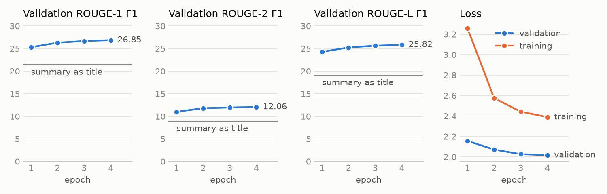

# Urdu headline generation with mT5

Fine-tunes [mT5-small](https://huggingface.co/google/mt5-small) to write the headline of a BBC
Urdu news article from its short summary, using the Urdu part of the
[XL-Sum](https://github.com/csebuetnlp/xl-sum) dataset. On the test split the fine-tuned model
reaches a ROUGE-L F1 of 26.28, against 19.20 for using the summary itself as the title.

CIS 6930 (Spring 2023) team project, Team 32 "Absolute Sum": Ammar Amjad, Mohammad Anas and
Michael Perez.

## Task

Every XL-Sum example is a BBC article with its title and a short summary written by the
journalist, usually a single sentence. The model is given the summary and generates the
title. The article body is not used, so despite the repository's name the task is headline
generation from a short summary, not summarization of the full article.

## Data

XL-Sum Urdu, version 2.0 (Hasan et al., 2021), licensed
[CC BY-NC-SA 4.0](https://creativecommons.org/licenses/by-nc-sa/4.0/). `urdu_headlines.data`
downloads the archive `urdu_XLSum_v2.0.tar.bz2` from the `csebuetnlp/xlsum` dataset on the
[Hugging Face Hub](https://huggingface.co/datasets/csebuetnlp/xlsum) at a pinned revision
(the archive stays in the Hugging Face cache), checks its SHA-256 and extracts the three JSONL
splits into `data/`. The data is not stored in this repository. As in the original notebook,
examples whose title has fewer than three words are dropped:

| Split | Examples | Kept |
| --- | ---: | ---: |
| train | 67,665 | 67,628 |
| validation | 8,458 | 8,454 |
| test | 8,458 | 8,454 |

## Approach

- **Model:** `google/mt5-small` fine-tuned with the Hugging Face `Seq2SeqTrainer` and the
  original notebook's settings: AdamW, learning rate 5.6e-5 with linear decay, batch size 8,
  weight decay 0.01. It trains for 4 epochs instead of 8: in the original run, validation
  ROUGE-1 recall rose by 0.26 and 0.17 points in epochs 3 and 4 (ROUGE-L recall by 0.18 and
  0.23). Seed 42, fp32 (mT5 is known to overflow in fp16).
- **Lengths:** measured in mT5 tokens on the training split. The longest summary (433 tokens)
  and the longest title (70 tokens) are the input and label limits, so no training example is
  truncated, and generation allows up to 71 positions (70 plus the decoder start token).
- **Evaluation:** after every epoch the model generates titles for the validation split
  (greedy decoding). The checkpoint with the best validation ROUGE-L F1 is kept and evaluated
  once on the test split.
- **Baseline:** the original notebook's baseline, which uses the summary as the title (its
  first three sentences; only 32 of the 8,454 test summaries have more than three).

## ROUGE on Urdu text

The `rouge-score` package, which the ROUGE metric in Hugging Face `evaluate` also uses,
lowercases the text and keeps only `a-z` and `0-9` by default. Every Urdu word is dropped, so
titles are compared only on their Latin letters and digits. A title without any becomes an
empty list of tokens and scores 0, even against itself, while the Somalia example in
`results/metrics.json` gets a ROUGE-1 F1 of 100: all that is left of its reference and
generated titles is the number 19. The original notebook found the zeros and switched to a
different package that splits on spaces, but reported recall only.

Here `rouge-score` gets a tokenizer that splits on whitespace
([`metrics.py`](src/urdu_headlines/metrics.py), tested in
[`test_metrics.py`](tests/test_metrics.py)). Precision, recall and F1 are reported for
ROUGE-1, ROUGE-2 and ROUGE-L, averaged over examples, and F1 is the main number because recall
alone rewards long outputs. The summary-as-title baseline shows the difference: on the test
split its ROUGE-1 recall is 52.00, but its F1 is 21.53, because a summary is about four times
longer than a title (33 words against 8 on average).

## Results

The numbers below come from one training run. All of them, with the run's settings and
library versions, are in [`results/metrics.json`](results/metrics.json).

Test split (8,454 examples), ROUGE F1:

| | ROUGE-1 | ROUGE-2 | ROUGE-L |
| --- | ---: | ---: | ---: |
| Summary as title (baseline) | 21.53 | 9.17 | 19.20 |
| mT5-small, fine-tuned | 27.40 | 12.62 | 26.28 |

Precision (P) and recall (R) on the same split:

| | Baseline P | Baseline R | Fine-tuned P | Fine-tuned R |
| --- | ---: | ---: | ---: | ---: |
| ROUGE-1 | 14.16 | 52.00 | 28.47 | 29.11 |
| ROUGE-2 | 6.03 | 22.66 | 13.34 | 13.35 |
| ROUGE-L | 12.61 | 46.60 | 27.30 | 27.91 |

The generated titles average 8.7 words, against 8.3 for the reference titles and 33.0 for the
summary-as-title baseline. The model's precision and recall are therefore close to each other,
while the baseline's high recall comes from its length.

Validation split (8,454 examples) after each epoch:

| Epoch | Training loss | Validation loss | ROUGE-1 F1 | ROUGE-2 F1 | ROUGE-L F1 |
| ---: | ---: | ---: | ---: | ---: | ---: |
| 1 | 3.26 | 2.16 | 25.28 | 11.00 | 24.28 |
| 2 | 2.57 | 2.07 | 26.30 | 11.80 | 25.24 |
| 3 | 2.44 | 2.03 | 26.67 | 11.96 | 25.63 |
| 4 | 2.39 | 2.02 | 26.85 | 12.06 | 25.82 |



The validation F1 scores rose after every epoch, by less each time (ROUGE-L F1 by 0.96, 0.39
and 0.19 points), so the best checkpoint is the last one, epoch 4 (step 33,816); it is the
model scored on the test split. The gray lines in the figure are the baseline's validation
scores (ROUGE-1, ROUGE-2 and ROUGE-L F1 of 21.40, 8.94 and 19.05). The training loss is the
mean of the losses logged during the epoch, with dropout active; the validation loss is
measured at the end of the epoch.

Three of the five random test examples stored in `results/metrics.json` (XL-Sum, BBC Urdu,
[CC BY-NC-SA 4.0](https://creativecommons.org/licenses/by-nc-sa/4.0/)). The English
translations were added for this README and are shared under the same license:

| | | Urdu | English translation |
| --- | --- | --- | --- |
| 1 | Summary | امریکہ نے شام کے صدر بشارالاسد کا ماسکو کے دورے پر ’والہانہ استقبال‘ کرنے پر شدید مذمت کی ہے۔ | The United States has strongly condemned the "rapturous welcome" given to Syrian President Bashar al-Assad on his visit to Moscow. |
| | Reference | بشار الاسد کا ماسکو میں ’پرتپاک استقبال،‘ امریکہ کی تنقید | Bashar al-Assad's "warm welcome" in Moscow, US criticism |
| | Generated | شام کے صدر بشارالاسد کا ماسکو پر شدید مذمت | Syrian President Bashar al-Assad's strong condemnation over Moscow (ungrammatical in Urdu) |
| 2 | Summary | ریاست اتر پردیش میں فیض آباد کی ایک ذیلی عدالت نے ضلع بارہ بنکی میں گرام سبھا کی ز مین بالی وڈ سٹار امیتابھ بچن کو پٹے (لیز) پر دینے کا حکم کالعدم قرار دیا ہے۔ | A lower court in Faizabad, in the state of Uttar Pradesh, has annulled the order to lease village council land in Barabanki district to Bollywood star Amitabh Bachchan. |
| | Reference | امیتابھ کے نام زمین کا پٹہ کالعدم | Land lease in Amitabh's name annulled |
| | Generated | امیتابھ بچن کو پٹے پر دینے کا حکم کالعدم | Order to lease to Amitabh Bachchan annulled |
| 3 | Summary | چین نے ایسے تیرہ ہزار افراد کی ایک فہرست جاری کی ہے جن کے متعلق اس کہنا ہے کہ انہیں جاپانی فوج نےانیس سو سینتیس کے ننجنگ قتل عام میں ہلاک کیا تھا۔ | China has released a list of thirteen thousand people who, it says, were killed by the Japanese army in the 1937 Nanjing massacre. |
| | Reference | ننجنگ قتل عام کی فہرست جاری | Nanjing massacre list released |
| | Generated | چین نے تیرہ ہزار افراد کی فہرست جاری کر دی | China releases a list of thirteen thousand people |

The first generated title is wrong and ungrammatical: it leaves out the United States and the
welcome, and reads as if Assad had condemned Moscow. The second says what the reference says in
other words. The third is correct but leaves out the Nanjing massacre, which is what the
reference title is about.

The [notebook](notebooks/urdu_headline_generation.ipynb) shows these results together with the
data analysis.

## How to run

Python 3.11 to 3.14: `uv.lock` pins the package versions of the reported run, and its PyTorch
(2.14.1) has no wheels for Python 3.15. `.python-version` makes uv use Python 3.12, as in the
reported run. Training, including the CPU check below, needs PyTorch 2.6 or newer, which is
not available for Intel Macs; a full run needs an NVIDIA GPU. On Intel Macs, `uv sync` builds
sentencepiece from source, which needs CMake (for example `brew install cmake`).

```bash
uv sync --extra train                         # or: pip install -e ".[train]"
uv run python -m urdu_headlines.data          # download XL-Sum Urdu into data/
uv run python -m urdu_headlines.baseline      # score the summary-as-title baseline
export PYTORCH_CUDA_ALLOC_CONF=expandable_segments:True  # less memory fragmentation
uv run python -m urdu_headlines.train         # fine-tune and evaluate (4 epochs)
uv run python -m urdu_headlines.predict --n 5 # titles for random test examples
```

On an RTX 2070 SUPER (8 GB), the reported run trained in fp32 for 2 hours 2 minutes: 84
minutes for the 33,816 steps of 4 epochs (6.7 steps per second on average, 5.2 to 7.7 between
log lines) and 38 minutes for the four validation passes. The test pass took 9 minutes. Peak
GPU memory was 6.2 GiB allocated by PyTorch (`torch.cuda.max_memory_allocated`, which leaves
out memory PyTorch has reserved but not allocated). The run used the `expandable_segments`
setting above, and memory was still tight on the 8 GB card: the allocator logged four
out-of-memory warnings, and training continued after each.

`train` writes to `outputs/`:

- `metrics.json`: settings, baseline and model scores (validation and test), per-epoch
  history, example predictions; [`results/metrics.json`](results/metrics.json) is this file
  from the reported run. Its `train_steps_per_second` is measured between log lines, so it
  leaves out the validation passes, checkpoint saves and the last steps of each epoch, and
  `peak_gpu_memory_gb` is in GiB.
- `log_history.json`: the Trainer's log (training loss, learning rate and gradient norm every
  200 steps, and the validation scores)
- `test_predictions.jsonl`: the generated title for every test example
- `model/`: the best checkpoint with its tokenizer. Its config sets `tie_word_embeddings` to
  false, as in `google/mt5-small`, because mT5's output layer has its own weights
  (transformers 5 would save true).
- `checkpoints/`: Trainer checkpoints; `--resume` continues an interrupted run

`uv run python -m urdu_headlines.train --help` lists the options. A quick check on the CPU
(about 2.4 GB of model downloads: the 1.2 GB checkpoint, and the same weights in safetensors
format, which transformers fetches in the background):

```bash
uv run python -m urdu_headlines.train --cpu --epochs 1 --output-dir outputs/smoke \
    --max-train-samples 64 --max-eval-samples 16 --max-test-samples 16
```

The notebook reads `results/metrics.json`; to show a new run, point `METRICS_PATH` in its first
code cell at `outputs/metrics.json`. It downloads the data if needed.
`uv run python -m urdu_headlines.plots` redraws the figure above from `results/metrics.json`.
Both need the notebook extra (`uv sync --extra notebook`, or `uv sync --all-extras` to keep the
training extra). Open the notebook with
`uv run jupyter lab notebooks/urdu_headline_generation.ipynb`.

Tests and lint (CPU only; the tests download nothing). The model tests in
[`test_train.py`](tests/test_train.py) build a tiny mT5 and need torch 2.6 or newer; without it
they are skipped.

```bash
uv run pytest
uv run ruff check . && uv run ruff format --check .
```

## Project layout

```
src/urdu_headlines/
  data.py         download, load and filter XL-Sum Urdu
  preprocess.py   tokenization, length statistics, decoding
  metrics.py      ROUGE-1/2/L precision, recall and F1 for Urdu
  baseline.py     summary-as-title baseline
  train.py        fine-tuning and evaluation with Seq2SeqTrainer
  predict.py      title generation with a trained model
  plots.py        chart of the validation scores and losses per epoch
notebooks/        walkthrough of the task, the ROUGE issue, the baseline and the results
results/          metrics of the reported run
docs/figures/     the chart in this README
tests/            unit tests
```

## History

The project began as a Google Colab notebook adapted from the Hugging Face course's
summarization notebook; it is in the git history. That notebook reported ROUGE recall only,
capped generation at 20 tokens, and never scored the test split; its saved training output ends
at epoch 4.76 of 8. This version replaces it with the scripts above, measures the length limits
in tokens, reports F1 and evaluates on the test split.

## References

- Hasan et al. (2021). [XL-Sum: Large-Scale Multilingual Abstractive Summarization for 44
  Languages](https://aclanthology.org/2021.findings-acl.413/). Findings of ACL-IJCNLP 2021,
  pages 4693-4703.
- Xue et al. (2021). [mT5: A Massively Multilingual Pre-trained Text-to-Text
  Transformer](https://aclanthology.org/2021.naacl-main.41/). NAACL-HLT 2021, pages 483-498.
- Lin (2004). [ROUGE: A Package for Automatic Evaluation of
  Summaries](https://aclanthology.org/W04-1013/). Text Summarization Branches Out, pages 74-81.
- Google Research, [`rouge-score`](https://github.com/google-research/google-research/tree/master/rouge).
- Hugging Face course, [Summarization](https://huggingface.co/learn/llm-course/chapter7/5) and
  its [notebook](https://github.com/huggingface/notebooks/blob/main/course/en/chapter7/section5_pt.ipynb),
  which the original notebook started from.
